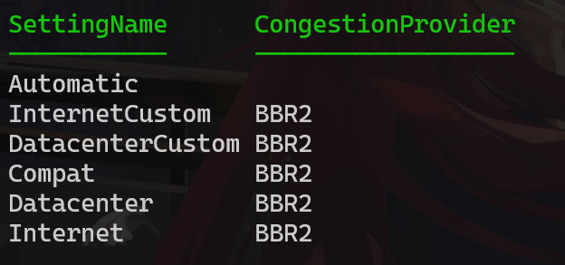

Ubuntu 26.04的sysctl不见了，换在以前还得研究半天，现在直接opus 5.5启动

## 1. 预加载内核模块

```bash
cat > /etc/modules-load.d/99-network-tuning.conf <<'EOF'
tcp_bbr
sch_fq
EOF
systemctl restart systemd-modules-load
```

理由：`systemd-sysctl` 在 `systemd-modules-load` 之后运行。若 `tcp_bbr` 未预加载，开机时 `tcp_congestion_control=bbr` 会静默失败，实际回落到 `cubic`。只在 `/etc/sysctl.conf` 里写 BBR 是不够的。


## 2. sysctl 参数

```bash
cat > /etc/sysctl.d/99-network-tuning.conf <<'EOF'
# BBR + fq
net.core.default_qdisc = fq
net.ipv4.tcp_congestion_control = bbr

# Socket 缓冲区（2–4GB 内存通用）
net.core.rmem_max = 16777216
net.core.wmem_max = 16777216
net.ipv4.tcp_rmem = 4096 131072 16777216
net.ipv4.tcp_wmem = 4096 65536 16777216

# 监听 / 接收队列
net.core.somaxconn = 8192
net.ipv4.tcp_max_syn_backlog = 8192
net.core.netdev_max_backlog = 16384

# 出站连接容量（代理 freedom 出站）
net.ipv4.ip_local_port_range = 10240 65535
net.ipv4.tcp_max_tw_buckets = 65536
net.ipv4.tcp_tw_reuse = 1
net.ipv4.tcp_fin_timeout = 15

# 延迟 / 恢复 / 连接保活
net.ipv4.tcp_fastopen = 3
net.ipv4.tcp_slow_start_after_idle = 0
net.ipv4.tcp_notsent_lowat = 131072
net.ipv4.tcp_mtu_probing = 1
net.ipv4.tcp_keepalive_time = 300
net.ipv4.tcp_keepalive_intvl = 30
net.ipv4.tcp_keepalive_probes = 5
EOF
```

若存在旧的 `/etc/sysctl.conf`，只注释掉与上面重复的键，避免互相覆盖（不要整段删除 `net.ipv4.*`，否则会误删 `ip_forward` 等 WireGuard / Docker 依赖的配置）：

```bash
if [ -f /etc/sysctl.conf ]; then
  cp /etc/sysctl.conf /etc/sysctl.conf.bak.$(date +%s)
  for k in $(awk -F'[ =]' '/^[a-z]/{print $1}' /etc/sysctl.d/99-network-tuning.conf); do
    sed -i -E "s|^\s*${k//./\\.}\s*=|# &|" /etc/sysctl.conf
  done
fi
sysctl --system
```

说明：Debian 13 起 `systemd-sysctl` 已不再读取 `/etc/sysctl.conf`，Ubuntu 26.04 上该文件通常不存在，此时上面的清理会自动跳过。若存在，它经 `99-sysctl.conf` 链接加载，排序在 `99-network-tuning.conf` 之后，重复键会覆盖本配置。

理由：

| 参数 | 理由 |
|---|---|
| `default_qdisc=fq` | BBR 依赖 pacing，fq 提供 per-flow pacing 并降低排队延迟 |
| `tcp_congestion_control=bbr` | 对长 RTT、有丢包的跨境链路吞吐明显优于 cubic |
| `rmem_max/wmem_max`、`tcp_rmem/tcp_wmem` | 放宽自动调节上限，让高 BDP 链路能填满带宽 |
| `somaxconn`、`tcp_max_syn_backlog` | 避免突发并发时 accept / SYN 队列溢出丢连接 |
| `netdev_max_backlog` | 避免软中断处理不及时导致收包丢弃 |
| `ip_local_port_range` | 代理出站每个目标都要占用源端口，扩大可用范围 |
| `tcp_tw_reuse`、`tcp_fin_timeout`、`tcp_max_tw_buckets` | 代理出站短连接多，加快 TIME_WAIT 回收 |
| `tcp_fastopen=3` | 客户端与服务端同时启用 TFO，减少一次握手往返（服务端需程序自行对监听 socket 开启 TFO，Caddy 默认不开，主要受益于 Xray 出站） |
| `tcp_slow_start_after_idle=0` | 长连接空闲后不退回慢启动，复用连接时不掉速 |
| `tcp_notsent_lowat` | 限制内核未发送积压，降低交互类流量延迟 |
| `tcp_mtu_probing=1` | 遇到 PMTU 黑洞时自动探测，避免大包卡死 |
| keepalive `300/30/5` | 更快清理对端已消失的死连接，释放资源 |

### 可选：conntrack（启用 ufw / nftables 等有状态防火墙时）

```bash
echo nf_conntrack >> /etc/modules-load.d/99-network-tuning.conf
systemctl restart systemd-modules-load

cat > /etc/sysctl.d/98-conntrack.conf <<'EOF'
net.netfilter.nf_conntrack_max = 262144
net.netfilter.nf_conntrack_tcp_timeout_established = 7200
net.netfilter.nf_conntrack_tcp_timeout_time_wait = 30
EOF
sysctl --system
```

理由：2–4GB 内存默认 `nf_conntrack_max` 仅 65536，代理每个请求占入站 + 出站两条记录，且 established 默认保留 5 天，满表后新连接会被静默丢包。未启用防火墙可跳过。


## 3. 开机强制应用 fq 到默认网卡

```bash
cat > /usr/local/sbin/network-qdisc.sh <<'EOF'
#!/bin/sh
DEV="$(ip -o -4 route show default | awk '{print $5; exit}')"
[ -n "${DEV}" ] || exit 0
if [ "$(ls -d /sys/class/net/${DEV}/queues/tx-* | wc -l)" -gt 1 ]; then
  # 多队列网卡：mq 子队列按 default_qdisc 自动创建为 fq
  tc qdisc replace dev "${DEV}" root mq
else
  tc qdisc replace dev "${DEV}" root fq
fi
EOF
chmod +x /usr/local/sbin/network-qdisc.sh

cat > /etc/systemd/system/network-qdisc.service <<'EOF'
[Unit]
Description=Apply fq qdisc to the default-route interface
After=network-online.target
Wants=network-online.target

[Service]
Type=oneshot
ExecStart=/usr/local/sbin/network-qdisc.sh
RemainAfterExit=yes

[Install]
WantedBy=multi-user.target
EOF

systemctl daemon-reload
systemctl enable --now network-qdisc.service
```

理由：`default_qdisc` 只影响之后创建的队列。网卡在 sysctl 生效前就已初始化时，仍会挂着 `fq_codel` 等默认队列。该服务开机自动读取默认路由网卡并重建队列，不硬编码接口名。2–4 vCPU 的 virtio 网卡通常是多队列，应保持 `mq` + 每队列 `fq`；直接 `root fq` 会把多队列合并成单队列，反而变差。无默认路由时脚本直接退出，不会让服务报 failed。


## 4. Xray 出站 socket 优化

备份后编辑 `/usr/local/etc/xray/config.json`，在 `freedom` 出站加入 `sockopt`：

```bash
cp /usr/local/etc/xray/config.json /usr/local/etc/xray/config.json.bak.$(date +%s)
```

```json
{
  "protocol": "freedom",
  "settings": {},
  "streamSettings": {
    "sockopt": {
      "tcpFastOpen": true,
      "tcpKeepAliveIdle": 120,
      "tcpKeepAliveInterval": 30,
      "tcpUserTimeout": 20000,
      "tcpCongestion": "bbr"
    }
  }
}
```

理由：

- `tcpFastOpen`：目标支持时省一次握手往返
- `tcpKeepAliveIdle/Interval`：比系统默认更快发现出站死连接
- `tcpUserTimeout=20000`：数据 20 秒未被确认即断开，避免连接长时间挂起占用资源
- `tcpCongestion=bbr`：显式指定出站 socket 用 BBR，不依赖系统默认值
- 不再写 `tcpNoDelay`：该选项已从 Xray-core 移除，Go 默认即开启 `TCP_NODELAY`

### 日志级别

```json
"log": {
  "loglevel": "error",
  "error": "/var/log/xray/error.log",
  "access": "/var/log/xray/access.log"
}
```

理由：前置反代通过 Unix Socket 转发时会带 `X-Forwarded-For`，Xray 无法校验来源，`warning` 级别会刷大量无用日志。保留 access 日志便于审计。

### 日志轮转

```bash
cat > /etc/logrotate.d/xray <<'EOF'
/var/log/xray/*.log {
    daily
    rotate 7
    missingok
    notifempty
    compress
    delaycompress
    copytruncate
}
EOF
```

理由：Xray 不自带轮转，小盘 VPS 容易被日志撑满。`copytruncate` 避免重启进程，且原文件属主 / 权限保持不变（使用 `copytruncate` 时 `create` 不生效，故不写）。

### 校验并重启

```bash
/usr/local/bin/xray run -test -config /usr/local/etc/xray/config.json
systemctl restart xray
```


## 5. Caddy 反代（XHTTP / 流式协议）

```caddyfile
handle /xhttp/* {
    reverse_proxy unix/@xhttp.sock {
        flush_interval -1
        transport http {
            versions h2c 2
        }
    }
}
```

理由：

- `flush_interval -1`：关闭响应缓冲，流式传输不被反代攒包
- `h2c 2`：与后端保持明文 HTTP/2，复用连接并支持多路复用


## 6. 验证

```bash
# BBR / fq 是否生效
sysctl net.ipv4.tcp_congestion_control net.core.default_qdisc
lsmod | grep -E 'tcp_bbr|sch_fq'
# 单队列应为 root fq；多队列应为 root mq，其下每个子队列为 fq
tc qdisc show dev "$(ip -o -4 route show default | awk '{print $5; exit}')"

# 新连接是否使用 BBR（旧连接不会热切换，仍显示 cubic 属正常）
ss -ti | grep -oE 'bbr|cubic' | sort | uniq -c

# 服务
systemctl is-active xray caddy network-qdisc

# Xray 文件句柄上限
grep 'open files' /proc/$(pidof xray)/limits

# 监听队列溢出 / 超时计数（持续增长需排查）
nstat -az TcpExtListenOverflows TcpExtListenDrops TcpExtTCPTimeouts

# conntrack 使用量（启用防火墙时）
cat /proc/sys/net/netfilter/nf_conntrack_count /proc/sys/net/netfilter/nf_conntrack_max
```

## 7. 注意事项

1. BBR 收益在长 RTT、有丢包链路上最明显；低延迟优质线路提升有限。
2. 已建立的连接不会切换拥塞算法，需重新连接。
3. 16MB 缓冲上限对 2–4GB 内存通用（约可覆盖 200ms RTT 下 600Mbps 单连接），全局占用受内核 `tcp_mem` 自动限制；并发大幅增长时观察内存后再调 `rmem/wmem`。
4. `tcp_notsent_lowat=131072` 偏向低延迟；偏重单连接大吞吐可测试后增大。
5. 排障时可临时将 Xray `loglevel` 改回 `warning` / `info`。


## 8. 客户端优化

Windows 11 22H2没有默认启用BBR策略

开启管理员Powershell，执行以下指令，便可以开启Windows客户端侧的BBR策略

```
netsh int tcp set supplemental Template=Internet CongestionProvider=bbr2
netsh int tcp set supplemental Template=Datacenter CongestionProvider=bbr2
netsh int tcp set supplemental Template=Compat CongestionProvider=bbr2
netsh int tcp set supplemental Template=DatacenterCustom CongestionProvider=bbr2
netsh int tcp set supplemental Template=InternetCustom CongestionProvider=bbr2

Get-NetTCPSetting | Select SettingName, CongestionProvider
```


